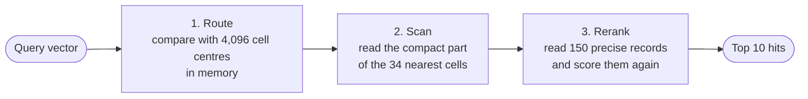
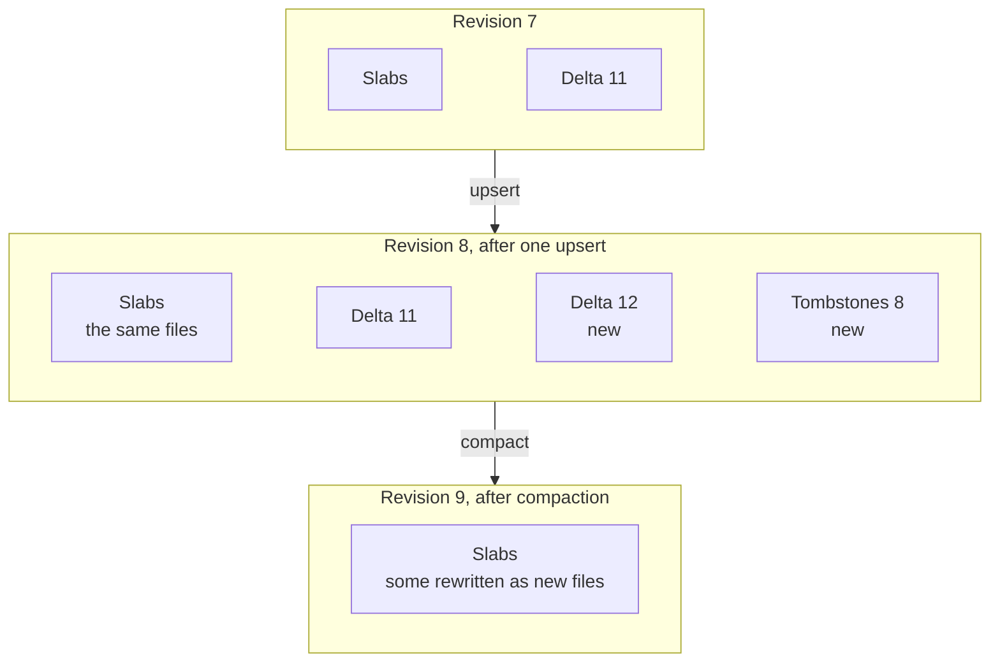

# How it works

This page explains the ideas behind thread in about ten minutes. You do not need it to use thread, but it helps
you understand what a query costs, why writes work the way they do, and which settings matter.

Each section ends with a link to the detailed page, for when you want every byte.

## An index is a folder of files

A thread index is a set of files under one prefix of a bucket. Nothing else exists: no server holds state.

```text
idx/
  current.json            the pointer: which generation and revision is live
  docs/                   one generation (you choose the name)
    manifest.7.json       revision 7: the list of files that make up the index
    fine.f32              the routing table: one centre point for each cell
    slab/00000 ...        one file per cell of vectors
    delta/12.vibd         vectors from a recent write, not merged yet
    seg/12.thread         text, metadata and keys from a recent write
    tombstones.7.u32      the ids that revision 7 deleted or replaced
```

Three words to know:

- A **generation** is one index, built for one embedding model. A bucket can hold several.
- A **revision** is one version of a generation. Every write makes a new revision.
- The **manifest** of a revision lists the files that belong to it.

**No file ever changes.** A write adds new files and a new manifest, then moves the pointer in `current.json`.
This one rule gives thread most of its properties:

- A file can stay in a cache for ever. It will never be wrong.
- A reader never sees a half-written index. It moves from one complete revision to the next.
- A copy of the files is a copy of the index. A backup is a copy.

## How a vector query finds its neighbours

You have 1 million vectors and one query vector. You want the 10 nearest. To compare the query with all 1 million
vectors, you would read about 6 GB. thread reads about 6 MB. It does this in three steps.



**Watch: how a vector finds its neighbours** (3 minutes). The film draws the cells, shows the neighbour that a
query misses across a cell border, and shows the fix.

[](https://www.inseam.io/thread/video/how-a-vector-finds-its-neighbours.mp4)

### Step 1: route

When the index is built, similar vectors are grouped into **cells**. Each cell has a centre point. The table of
all centre points is the only large thing a reader keeps in memory (25 MB for 4,096 cells of 1,536 dimensions).

A query compares itself with every centre point and picks the nearest cells. The number of cells it picks is
`nprobe`. More cells mean better recall and more bytes read.

A true neighbour can sit just across the border of a cell that was not picked. To prevent that, the benchmark
index stores each vector in its 3 nearest cells, not only in 1. A query that reads a cell then also finds the
neighbours that live near its edges.

### Step 2: scan

Each cell is one file, called a **slab**. A slab stores every vector twice:

| Part of the slab | Size for each vector (1,536 dimensions) | Used for |
|---|---:|---|
| Scan codes (product quantization) | 208 bytes | A fast, rough score for every vector in the cell |
| Rerank records (8-bit integers) | 1,540 bytes | A precise score for the best candidates only |
| For comparison: the original floats | 6,144 bytes | Not stored |

The scan codes are at the start of the file. The query reads only that part, with one range request for each
cell, and gives every vector a rough score. Filters and deletes are applied here, before a vector can become a
candidate.

### Step 3: rerank

The rough scores are good enough to find the best 150 candidates, but not to order them exactly. So the query
reads the precise records of those 150 candidates only, and scores them again. The best 10 are the answer.

The result on the 1M benchmark: 95% recall, about 6 MB read from cache, and about 33 ms of CPU for each query.

The numbers in this section are from the benchmark index, which was built in one pass over 1 million vectors. An
index that you create empty and fill with upserts starts with a simpler layout: one cell, each vector in one
cell, and 4-bit scan codes in place of product quantization. The three steps are the same, and cells split as the
index grows. [Create an index](create-an-index.md) explains the two ways to build.

**Settings that matter:** `nprobe` (cells to scan) and `rerank` (candidates to score again). The index stores good
defaults, and most applications never change them.

Details: [Query path](query-path.md), [Profiles](profiles.md).

## How text search works

Text is stored in **segments**, beside the slabs. A segment holds three things for a batch of documents:

- **Postings**: for each word, the documents that contain it. This is a standard BM25 index.
- **Docs**: for each document id, its metadata and (if you want) its text.
- **Keys**: for each string key, its document id.

A text query is cut into words and reduced to stems (`deployments` becomes `deploy`). It then reads the postings
of those words in two rounds of range requests, and scores the documents with BM25. Like a vector query, it reads
small ranges of cached files, never a whole segment.

Vectors and text use the same document ids. One `upsert` adds a vector, its text and its metadata. One `delete`
hides all three.

Details: [Text index](lexical.md), [Keys](keys.md).

## How hybrid search merges two lists

A vector search and a text search give two ranked lists, with scores on different scales. A cosine similarity
of 0.82 and a BM25 score of 11.4 cannot be added.

thread uses **Reciprocal Rank Fusion**. It ignores the scores and uses only the positions. Each document gets
`1 / (60 + rank)` from each list it is in, and the two values are added.

| Document | Rank in the vector list | Rank in the text list | Fused score |
|---|---:|---:|---:|
| A | 1 | 3 | 1/61 + 1/63 = 0.0323 |
| B | 2 | not found | 1/62 = 0.0161 |
| C | not found | 1 | 1/61 = 0.0164 |

Document A wins because both searches agree on it, even though it is first in only one list. That is the
behaviour you want: exact words and meaning support each other.

Details: [Search](search.md), [Text index](lexical.md).

## How a write works without changing a file

No file can change. So how do you add, replace or delete a document?



- An **upsert** writes a small **delta** file with the new vectors, a **segment** with the new text, and a
  **tombstone** file that lists the ids it replaced. Then it writes a new manifest that lists the old files and
  the new ones.
- A **delete** writes only a tombstone file and a new manifest.
- A **query** scans the slabs and every delta, and drops any result whose id is in a newer tombstone file.

Two writers cannot both create the same manifest: the store accepts only the first one, and the second writer
tries again on top of it. No lock server is needed.

Each write adds files that every later query must read. So thread **compacts**: it merges deltas into new slab
files, merges segments, and drops tombstones that hide nothing any more. A cell that grows past 3,000 vectors is
split into two. Compaction makes a new revision, like any other write, and readers move to it without an error.

What this means for you:

- **Batch your writes.** One write of 100 documents is far cheaper than 100 writes of one document.
- **A new write is visible to other readers after about 30 seconds.** Readers check the pointer in the background
  when they search. The handle that made the write sees it at once.
- **Compaction must run somewhere.** [Run it in production](production.md) shows how.

Details: [Update path](update-path.md).

## Why this is cheap

| Fact | Result |
|---|---|
| Files never change | An edge cache or a disk cache can serve nearly every read. With a warm cache, a query reads nothing from the bucket. |
| A query reads ranges, not files | About 6 MB for each query at 1 million vectors, not gigabytes. |
| The only state in memory is the routing table | A reader fits in a 128 MB Cloudflare Worker. Any number of readers can run in parallel. |
| The work is simple arithmetic | Table lookups and additions, in Rust compiled to wasm or to native code. About 33 ms of CPU for each query. |
| Nothing runs between queries | An idle index costs only its storage. |

Details: [Benchmarks](benchmarks.md), [Cold start](cold-start.md).

## Go deeper

| Page | What it covers |
|---|---|
| [Architecture](architecture.md) | The whole design on one page, and where the code is |
| [Query path](query-path.md) | Slab formats, the two-phase query, caches, routing |
| [Update path](update-path.md) | Revisions, deltas, tombstones, compaction, cell splits, garbage collection |
| [Text index](lexical.md) | Segment formats, the tokenizer, fusion, tuning |
| [Profiles](profiles.md) | The layout settings and what each one trades |
| [Cold start](cold-start.md) | What the first query of a new process costs, and how to make it cheaper |
| [Benchmarks](benchmarks.md) | Every measurement, with the method |
