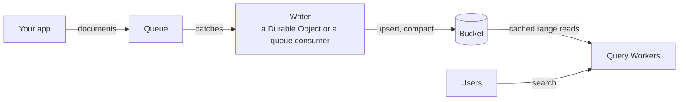

# Run it in production

thread has no server, so there is little to operate. This page is the short list of things to get right before
you serve real traffic. Each item says what to do and why.

## Checklist

| Do this | Why |
|---|---|
| [Open the index once](#open-the-index-once) | Opening loads a routing table. Do it once for each isolate or process, not for each request. |
| [Batch your writes](#batch-your-writes) | A write of 1 document costs the same requests as a write of 1,000. |
| [Write from one place](#write-from-one-place) | Fewer retries, and write memory stays out of your query path. |
| [Run compaction](#run-compaction) | Without it, every write makes every later query a little slower. |
| [Delete old files](#delete-old-files) | Compaction leaves the files it replaced in the bucket. |
| [Know your freshness](#know-your-freshness) | Other readers see a write within 30 seconds, not at once. |
| [Watch the numbers](#watch-the-numbers) | Every result carries its own timings and I/O counts. |
| [Keep a copy](#keep-a-copy) | The index is files. A backup is a copy. |

## Open the index once

`Thread.init` compiles the engine, and `open` reads the manifest and the routing table. Keep both for the life of
the isolate or process.

```ts
let index: Promise<ThreadIndex> | undefined;

function getIndex(env: Env, ctx: ExecutionContext) {
  index ??= Thread.init({ wasmModule }).then((thread) =>
    thread.open({ bucket: env.BUCKET, embed: { ai: env.AI }, waitUntil: (p) => ctx.waitUntil(p) }),
  );
  return index;
}
```

In Python, open one index at start-up and share it. A `ThreadIndex` is safe to use from several threads. Its
calls block, so from asyncio run them in a thread: `await asyncio.to_thread(index.search, text=q)`.

An open index follows new revisions by itself. You do not need to open it again after a write.

## Batch your writes

Every `upsert` or `delete` is one revision: about ten requests to the store, a new manifest, and new small files
that queries must read until compaction merges them.

- Send at least 64 documents in a call, or everything that arrived in the last second.
- Send one call for one logical unit (a crawled page, an imported file), not one call for each row.
- One call holds at most 4,096 documents.

If documents arrive one at a time, put a queue in front of the writer (a Cloudflare Queue, a buffer in a Durable
Object) and write each batch.

## Write from one place

Concurrent writers are safe. The store accepts one new revision, and the other writer builds on it and tries
again. But a writer that loses the race does its work twice.

A good design is one writer for each index:



In Workers, keep writes out of the isolates that answer queries. A write holds the routing table twice, and wasm
memory never shrinks, so a query isolate that also writes keeps that memory for the rest of its life. A Durable
Object or a separate Worker for writes avoids this.

For writers, prefer the R2 binding or a file store. The S3 path uses conditional requests (`If-None-Match`,
`If-Match`), which R2 and AWS S3 document, but thread has not verified them against a live endpoint yet.

## Run compaction

Compaction merges the small files that writes leave behind, and splits cells that grew too large. Who runs it
depends on how you write:

| You write through | Compaction |
|---|---|
| The reference Worker (`/upsert`, `/delete`) | Automatic. The Worker starts it after a write that passes a threshold. |
| The TypeScript SDK | You call it. A few lines, below. |
| The Python SDK | Python does not compact vectors. Run the TypeScript lines from a small script or a Worker, on a schedule. |

In the writer, after a write:

```ts
// Vectors: merge delta files into the cells, split large cells
if (index.compactionDue().due) {
  let run;
  do run = await index.compact();        // one bounded slice for each call
  while (run.more);
}
```

`compactionDue()` reads nothing from the store. It compares the open revision with the thresholds of the index:
more than 16 delta files, more than 32 MB of them, or more than 50,000 replaced or deleted ids.

Each `compact()` call is bounded in memory (48 MiB by default), in cells and in time (27 seconds), so it fits a
Worker or a Durable Object alarm. It takes a lock in the bucket, so two compactions never run at once. If a call
is interrupted, the next one continues. Queries during a compaction are not affected.

The text side has its own merge. Run it from time to time, for example after every 16 writes or once a day:

```ts
await index.compactSegments();           // TypeScript
```

```python
index.compact_segments()                 # Python can do this one
```

Details and every option: [compaction in the SDK](update-path.md#compaction-in-the-sdk).

## Delete old files

Nothing is deleted when you write, compact or delete documents. Old revisions stay readable, which is what makes
reads consistent and rollbacks possible. Garbage collection removes files that no recent revision uses.

```ts
const report = await index.gc();                                    // a dry run: what would be deleted
await index.gc({ keep: 2, graceSec: 300, dryRun: false });          // keep the 2 newest revisions
```

Run it on a schedule, for example once a day. `graceSec` protects files that a writer made in the last few
minutes and has not committed yet.

## Know your freshness

| Event | Visible to |
|---|---|
| A write | The handle that wrote: at once. Other open indexes: within `refreshInterval` (30 seconds by default). |
| `await index.refresh()` | That index: at once |
| A switch to a new generation | Readers that follow the pointer: within `refreshInterval` |

If a user must see their own write at once (read-your-writes), run their next query on the handle that wrote, or
call `refresh()` first. A shorter `refreshInterval` gives faster visibility for one more small read per interval.

## Watch the numbers

Every result has a `stats` object: the time of each phase, the bytes read, the cache hits and misses. Every
operation also produces a **trace**, one JSON object with the same shape in both SDKs.

```ts
const index = await thread.open({
  bucket: env.BUCKET,
  onTrace: (trace) => console.log(JSON.stringify(trace)),   // one line for each sampled operation
  traceSample: 0.01,                                         // 1% of operations
});
```

What to watch:

| Signal | Healthy | If not |
|---|---|---|
| Cache misses for each query (`stats.io.misses`) | Near 0 after warm-up | Traffic is too low to keep the edge cache warm, or the revision changes very often |
| Delta files in the revision (`compactionDue().pressure.deltas`) | Under 16 | Compaction is not running, or writes are too small |
| Write conflicts (`result.conflicts`) | 0 | More than one writer. Use one writer. |
| Query time (`stats.timing.total`) | Stable | Read the phases to find which step grew |

[Observability](observability.md) explains traces, sinks and how to find a bottleneck.

## Keep a copy

```ts
import { copyObjects, snapshotKeys } from "@aiuitech/thread-sdk";

// One consistent revision, to another bucket or a folder
await copyObjects(source, backup, ["idx/current.json", ...snapshotKeys(index.revision)]);
```

Or pack one revision into a single file: [Move an index](portability.md).

An earlier revision stays readable while garbage collection has not removed its files:
`thread.open({ store, gen: "docs", rev: 41 })` opens revision 41 and stays on it. To make an earlier state the
live one again, copy your backup into place, or use the reference Worker's
[`/build/rollback`](update-path.md#write-path).

## Cold starts

The first query of a new isolate or process reads the routing table and finds an empty cache, so it is slower
than the others. With steady traffic on Workers you will rarely see it, because the edge cache is shared by all
isolates.

If cold starts matter (low traffic, or a process that starts for each job), these help, in this order:

1. A disk cache, for Node and Python ([Connect to storage](storage.md#caches)).
2. `routing: "i8"`, which loads a routing table 4 times smaller.
3. A pack file on local disk.

[Cold start](cold-start.md) has the measurements for each option.

## Limits to plan for

- Document ids are unsigned 32-bit integers: about 4.2 billion for each index.
- One call writes at most 4,096 documents.
- A filter can use 32 bits of fields for each document.
- A Worker isolate has 128 MB. The routing table of a 1-million-vector index uses 25 MB of it.

[Limits and status](limits.md) has the full list.
